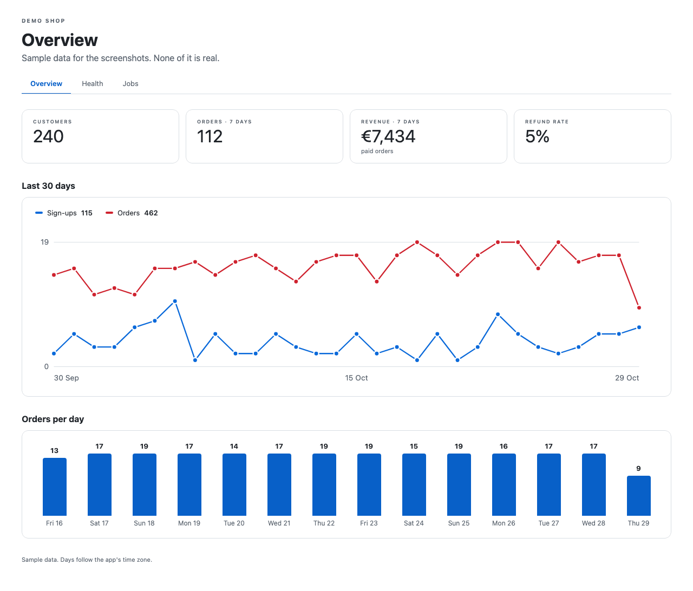
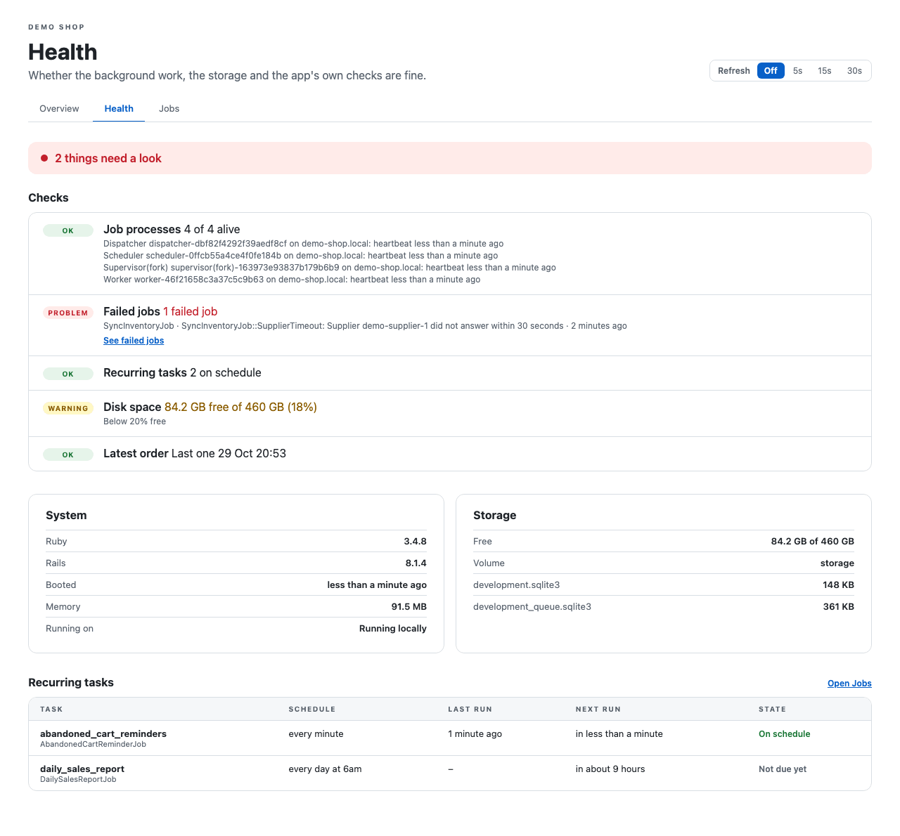
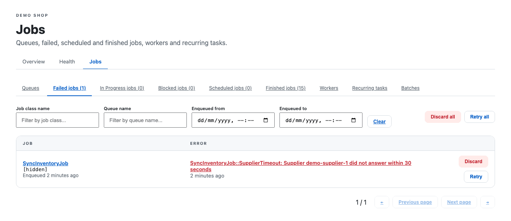

# Sightline

**An admin dashboard for your Rails app, in your app's own look: your numbers, whether everything is working, and
your background jobs. One gem, one generator, one initializer.**

[](https://github.com/andrebras/sightline/actions/workflows/ci.yml)
[](LICENSE)
[](https://www.ruby-lang.org)
[](https://rubyonrails.org)



Most Rails apps end up with the same admin pages: a few key numbers, a "is everything OK?" page someone checks when a
user complains, and a jobs dashboard. Sightline gives you all three, behind the admin check you already have.

| Page | What it shows |
|---|---|
| **Overview** | The numbers you declare: stat cards, daily trend lines, bars per day. Charts are drawn on the server. |
| **Health** | Whether things are working: Solid Queue's processes, failed jobs, recurring tasks that missed their schedule, free disk space, your own checks, and the system and storage it runs on. All green, or exactly what needs a look. |
| **Jobs** | [Mission Control – Jobs](https://github.com/rails/mission_control-jobs), set up for you: same admin check, same layout, job arguments hidden, look-only until you allow actions. |

<details>
<summary>Screenshots of Health and Jobs</summary>





Job actions are switched on here (`c.job_actions = true`); they're off by default.

</details>

## Why Sightline

- **No sign-in, no layout and no look of its own.** It inherits a controller you already have, so your sign-in
  and admin check decide who gets in. It renders inside your layout and takes your colours.
- **Everything in one initializer.** No migrations, no admin DSL (a special language for describing admin pages) to
  learn: a stat is a block that returns a number, and a check is a block that returns ok, warning or problem.
- **Safe by default.** Job actions (retry, discard, run now) are off, and job arguments, which often hold people's
  emails and names, are hidden. Without an admin controller set, nothing is served.
- **Knows Solid Queue.** It works out from each recurring task's schedule whether it should have run, so a job that
  quietly stopped shows up on Health, with no thresholds to tune.

## Contents

- [Requirements](#requirements)
- [Quick start](#quick-start)
- [Usage](#usage)
- [Notes and troubleshooting](#notes-and-troubleshooting)
- [Reference](#reference)
- [Contributing](#contributing)
- [Changelog](#changelog)
- [License](#license)

## Requirements

- Ruby 3.4 or newer
- Rails 8 or newer
- [Solid Queue](https://github.com/rails/solid_queue), Rails' database-backed job queue

Sightline brings Mission Control – Jobs with it.

## Quick start


The recording above, sped up, installs Sightline in a brand-new app: the pages work straight away, with no data yet.

1. **Add the gem** to your `Gemfile`. It is installed from GitHub, pinned to a release tag:

   ```ruby
   gem "sightline", github: "andrebras/sightline", tag: "v0.1.2"
   ```

2. **Have an admin controller.** Sightline's pages inherit it, so it must refuse everyone who isn't an admin. If you
   don't have one yet, something like this, using the authentication Rails 8 generates:

   ```ruby
   # app/controllers/admin/base_controller.rb
   module Admin
     class BaseController < ApplicationController
       before_action { head :not_found unless Current.user&.admin? }
     end
   end
   ```

3. **Run the generator:**

   ```sh
   bundle install
   bin/rails generate sightline:install --base-controller=Admin::BaseController --mount-at=/admin
   bin/rails db:prepare
   ```

   It writes `config/initializers/sightline.rb` and mounts Sightline in `config/routes.rb`. It also gives development
   and test their own Solid Queue database, as production has, so Health and Jobs show real jobs locally. See
   [Notes and troubleshooting](#notes-and-troubleshooting) if your app keeps Solid Queue in its primary database or
   doesn't use SQLite.

4. **Let your layout yield `:head`** (optional), so Jobs can ask search engines and Turbo not to index, cache or
   prefetch its pages. Jobs adds no import map of its own, so it works beside your app's `javascript_importmap_tags`.

   ```erb
   <head>
     ...
     <%= yield :head %>
   </head>
   ```

5. **Open `/admin`.** With only the admin controller set you already get:
   - **Health**, with every built-in check: disk space, and where Solid Queue is your job adapter, job processes,
     failed jobs and recurring tasks;
   - **Jobs**;
   - an empty **Overview**, waiting for your numbers.

   Run your jobs locally (`bin/jobs`, or `SOLID_QUEUE_IN_PUMA=1 bin/rails server`) to see them working.

## Usage

Everything below goes in `config/initializers/sightline.rb`. Blocks run on each page view, never at boot, so they can
use your models and service objects.

### Your numbers on the Overview

```ruby
Sightline.configure do |c|
  c.base_controller = "Admin::BaseController"
  c.title = "How Shop is doing"

  c.stat("Customers") { User.count }
  c.stat("Orders · 7 days") { Order.where(created_at: 7.days.ago..).count }

  # A line per series over the last 30 days. Return counts grouped by day; missing days count as 0.
  c.trend("Last 30 days", days: 30) do |dates|
    since = dates.first.beginning_of_day
    {
      "Sign-ups" => User.where(created_at: since..).group("date(created_at)").count,
      "Orders" => Order.where(created_at: since..).group("date(created_at)").count
    }
  end

  c.bars("Orders per day", days: 7) do |dates|
    Order.where(created_at: dates.first.beginning_of_day..).group("date(created_at)").count
  end
end
```

### Your own checks on Health

Return `Sightline.ok`, `Sightline.warning` or `Sightline.problem`, with a short summary and an optional detail. A check
that raises, or returns anything else, shows as a problem, so a broken check is never mistaken for a passing one.

```ruby
c.check("Payment webhooks") do
  last = PaymentEvent.maximum(:created_at)
  if last.nil? then Sightline.warning("None received yet")
  elsif last < 1.day.ago then Sightline.problem("None for a day", detail: "Last one #{last.to_fs(:short)}")
  else Sightline.ok("Last one #{last.to_fs(:short)}")
  end
end
```

### Letting admins act on jobs

```ruby
c.job_actions = true        # retry, discard, pause queues, run recurring tasks now
c.show_job_arguments = true # only if arguments never hold personal data
```

### Your look

Sightline's classes start with `sl-`, and its colours and fonts are CSS custom properties with neutral defaults. Set
yours on `.sl` in your own stylesheet:

```css
.sl{--sl-accent:#486440;--sl-font-heading:Georgia,serif}
```

Text colours must reach a contrast of 4.5:1 on your page background (WCAG AA, the usual level of the Web Content
Accessibility Guidelines). The defaults do, on white and on light tinted pages.
If your accent is lighter than that, keep it for lines and bars and set `--sl-accent-text` to a darker shade, for links,
the current tab and the selected refresh choice (white text on it):

```css
.sl{--sl-accent:#a96b43;--sl-accent-text:#8f5835}
```

If your layout already links the admin pages, turn off Sightline's own section links with `c.navigation = false`.

### Pages of your own

```ruby
c.page "Refunds", path: "refunds", template: "admin/refunds"
```

The page is listed after Overview, Health and Jobs, at `/admin/refunds`. Its template can use the same
[pieces](docs/reference.md#pieces) as Sightline's pages.

## Notes and troubleshooting

**Where the pages are.** The pages are at `/admin`, `/admin/health` and `/admin/jobs`. To link to them from your app,
use `sightline.overview_path`, `sightline.health_path` and `sightline.jobs_path`.

**Mounting.** Mount Sightline after your app's own `/admin` routes, so those keep their paths. Don't mount Mission
Control yourself.

**`config/database.yml`.** The generator changes it only when it has the plain shape `rails new` writes; otherwise it
tells you what to add, there and in `config/environments/development.rb` and `test.rb`, and changes neither.

**Solid Queue in the primary database.** If your app keeps Solid Queue's tables in its primary database, the generator
adds no queue databases. It assumes so when production in `config/database.yml` has no `queue` database; say so either
way with `--queue-in-primary` or `--no-queue-in-primary`.

**Disk space check.** Health's disk space check expects SQLite on a local volume, and you can turn it off
(`c.storage_check = false`). When your databases aren't SQLite, the initializer suggests where the check should look
(`storage_path`), or turning it off.

## Reference

Every setting, declaration, helper and style property is listed in [docs/reference.md](docs/reference.md), with how
Health decides what is wrong and how Jobs is set up.

## Contributing

Bug reports and pull requests are welcome: open an [issue](https://github.com/andrebras/sightline/issues) or a
[pull request](https://github.com/andrebras/sightline/pulls) on GitHub.

To work on Sightline, clone the repository, run `bundle install`, then:

```sh
bin/test                 # tests, against a dummy app with real Solid Queue records
bundle exec rubocop      # lint
```

Both also run on GitHub Actions for every push and pull request.

## Changelog

See [CHANGELOG.md](CHANGELOG.md).

## License

MIT. See [LICENSE](LICENSE).
